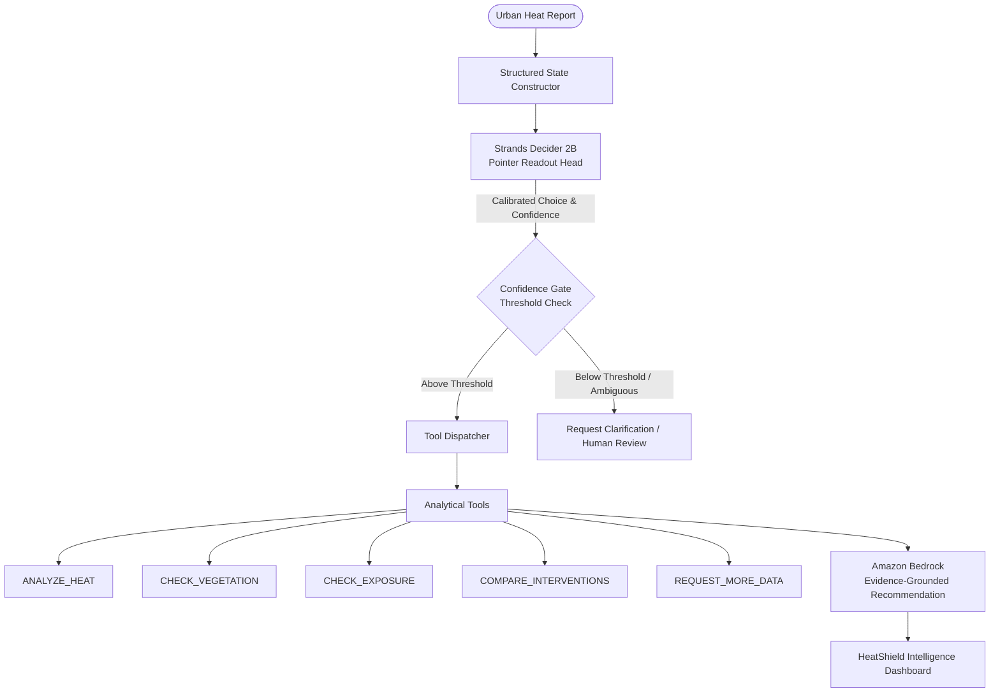

# HeatShield AI

**HeatShield AI** is an AI-powered environmental decision agent built for the AWS Strands Decider 2B Agent Experience Hackathon. It analyzes urban heat-risk reports, makes calibrated analytical tool-selection decisions using **Strands Decider 2B**, executes modular analytical tools, and uses **Amazon Bedrock** to generate evidence-grounded municipal resilience recommendations.

---

## 🏛️ System Architecture



## 🚀 Key Features

1. **Confidence-Aware Tool Selection**: Uses the official `strands-decider` System One API (`ChoiceQuestion` and pointer readout) for sub-second tool routing.
2. **Deterministic Tool Execution**: Five independent, strictly typed environmental analysis modules.
3. **Evidence-Grounded Generative Reasoning**: Amazon Bedrock synthesizes findings without hallucinating fake tool outcomes.
4. **Transparent Execution Trace**: Complete auditability showing state construction, model confidence, latency, tool output, and final recommendation.
5. **Robust Fallbacks & Dev Mode**: Safe degradation when weights or AWS credentials are not configured, explicitly labeled without fabricating outputs.

---

## 🛠️ Getting Started

### Prerequisites

- Python 3.10+
- Node.js 18+ and npm
- AWS Account with Amazon Bedrock access (optional for Dev Mode)

### Backend Setup

```bash
# Activate virtual environment
# Windows:
.venv\Scripts\activate
# Linux/macOS:
source .venv/bin/activate

# Install dependencies
pip install -r backend/requirements.txt

# Run the API
uvicorn backend.app.main:app --host 0.0.0.0 --port 8000 --reload
```

### Frontend Setup

```bash
cd frontend
npm install
npm run dev
```

---

## 📄 License

Apache License 2.0. See [LICENSE](LICENSE) for details.
