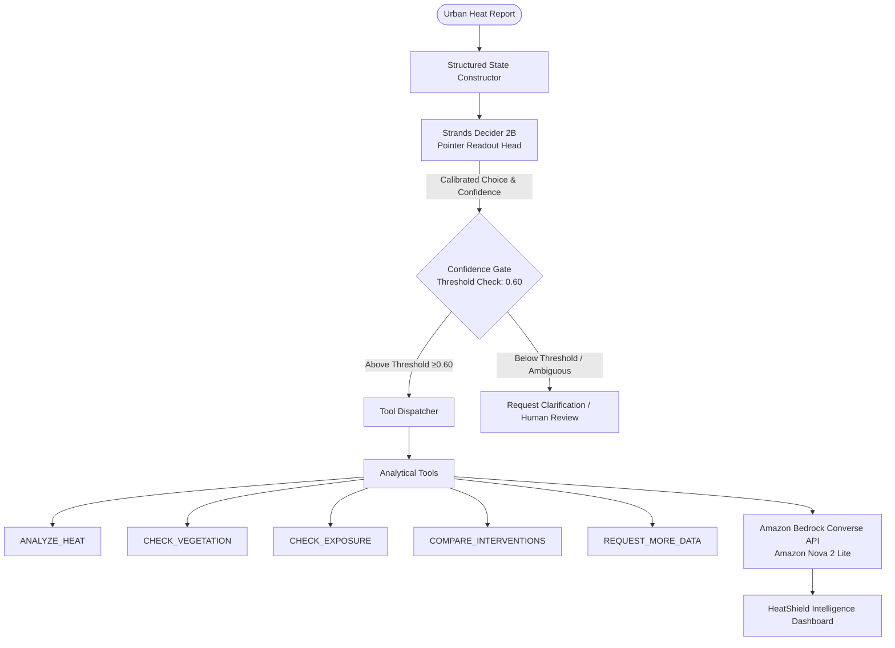

# HeatShield AI

**HeatShield AI** is an AI-powered environmental decision agent built for the AWS Strands Decider 2B Agent Experience Hackathon. It analyzes urban heat-risk reports, makes calibrated analytical tool-selection decisions using **Strands Decider 2B**, executes modular analytical tools, and uses **Amazon Bedrock** to generate evidence-grounded municipal resilience recommendations.

---

## 🏛️ System Architecture



### Decision & Reasoning Pipeline

1. **Environmental Ingestion & State Construction**: Raw reports and observations are normalized into structured states with inferred data gaps.
2. **Strands Decider 2B Selection**: Evaluates a typed `ChoiceQuestion` over the 5 predefined analytical actions with sub-second calibrated confidence.
3. **Confidence Gate (0.60)**: Actions with confidence $\ge 0.60$ proceed to automated execution. Decisions below threshold are safely gated for human clarification without running tools.
4. **Deterministic Analytical Tools**: Executes one of 5 independent Python modules producing verified findings.
5. **Amazon Bedrock Generative Reasoning**: The Bedrock Runtime `converse` API (Amazon Nova 2 Lite) synthesizes recommendations grounded strictly in verified tool outputs and observations, distinguishing observations from operational assumptions and requiring municipal human review before deployment.

---

## 🚀 Key Features

1. **Confidence-Aware Tool Routing**: Sub-second routing via `strands-decider` System One API.
2. **Deterministic Environmental Tool Execution**: 5 strictly typed, modular analytical tools.
3. **Evidence-Grounded Generative Reasoning**: Amazon Bedrock synthesizes findings without hallucinating fake tool outcomes.
4. **Truthful Status Reporting**: Clearly distinguishes live Bedrock inference, transparent development fallbacks, expired credentials, and access-denied errors.
5. **Credential Safety**: Strict adherence to least privilege; never logs, commits, or exposes AWS credentials.
6. **Transparent Execution Trace**: Complete auditability showing state construction, model confidence, latency, tool output, and final recommendation.

---

## ☁️ Amazon Bedrock Configuration

HeatShield AI uses the standard `boto3` Bedrock Runtime `converse` API. Configuration is dynamically loaded via environment variables:

| Variable | Default Value | Description |
| :--- | :--- | :--- |
| `AWS_REGION` | `us-east-1` | AWS region hosting Amazon Bedrock |
| `BEDROCK_MODEL_ID` | `global.amazon.nova-2-lite-v1:0` | Target model ID or inference profile |
| `BEDROCK_TEMPERATURE` | `0.2` | Generation temperature for grounded reasoning |
| `BEDROCK_MAX_TOKENS` | `1024` | Maximum tokens for synthesis output |
| `BEDROCK_TIMEOUT_SECONDS` | `15` | Read timeout for Bedrock Converse requests |

### Supported Bedrock Model Identifiers

- **Amazon Nova 2 Lite (Global Profile - Recommended)**: `global.amazon.nova-2-lite-v1:0`
- **Amazon Nova 2 Lite (US Regional Profile)**: `us.amazon.nova-2-lite-v1:0`
- **Amazon Nova Lite (Direct Model)**: `amazon.nova-lite-v1:0`
- **Anthropic Claude 3 Haiku**: `anthropic.claude-3-haiku-20240307-v1:0`

---

## 🛠️ Getting Started

### Prerequisites

- Python 3.10+
- Node.js 18+ and npm
- AWS Account or AWS Workshop Studio with Bedrock access (optional for Dev Mode)

### Backend Setup

```powershell
# Activate virtual environment (Windows PowerShell)
.\.venv\Scripts\Activate.ps1

# Install dependencies
pip install -r backend/requirements.txt

# Run the FastAPI server
uvicorn backend.app.main:app --host 0.0.0.0 --port 8000 --reload
```

### Frontend Setup

```powershell
cd frontend
npm install
npm run dev
```

---

## ▲ Deploying on Vercel

HeatShield AI is configured for one-click full-stack deployment on Vercel combining the Vite React SPA and FastAPI Python serverless functions.

- **Vercel Entrypoint**: `api/index.py` handles all `/api/*` endpoints.
- **Frontend Build**: Vite compiles to `frontend/dist/` and is served via Vercel Edge CDN.
- **Configuration**: Managed automatically via [`vercel.json`](vercel.json).

### Vercel Environment Variables

Set these in your **Vercel Project Settings > Environment Variables**:

| Variable | Required | Description |
| :--- | :---: | :--- |
| `AWS_REGION` | **Yes** | AWS Region for Bedrock (e.g. `us-east-1`) |
| `BEDROCK_MODEL_ID` | **Yes** | Bedrock Model ID (default: `global.amazon.nova-2-lite-v1:0`) |
| `BEDROCK_TEMPERATURE` | No | Sampling temperature (default: `0.2`) |
| `AWS_ACCESS_KEY_ID` | **Yes\*** | Server-side AWS credentials |
| `AWS_SECRET_ACCESS_KEY` | **Yes\*** | Server-side AWS secret access key |
| `AWS_SESSION_TOKEN` | Optional | Session token if using temporary workshop credentials |
| `DECIDER_REMOTE_URL` | Optional | Remote Strands Decider 2B endpoint for live model inference |
| `ENVIRONMENT` | No | `production` |

For complete deployment details and execution limit considerations, see [docs/VERCEL_DEPLOYMENT.md](docs/VERCEL_DEPLOYMENT.md).

---

## 🧪 Testing

### Running Backend Tests

The project includes unit tests with mocked AWS responses as well as real Decider 2B forward passes:

```powershell
# Run all unit tests (fast, does not require real model download)
pytest -m "not integration"

# Run the complete test suite (all 38 tests including real Decider forward pass)
pytest
```

### Running Frontend Production Build

```powershell
cd frontend
npm run build
```

---

## 🔬 Manual Bedrock Converse Smoke Test

To verify connectivity with Amazon Bedrock without starting the web server or committing credentials, run the standalone smoke test script from Windows PowerShell:

```powershell
# 1. (Optional) Set temporary AWS Workshop Studio credentials in your active session
$env:AWS_DEFAULT_REGION = "us-east-1"
$env:AWS_REGION = "us-east-1"
$env:BEDROCK_MODEL_ID = "global.amazon.nova-2-lite-v1:0"
$env:AWS_ACCESS_KEY_ID = "<YOUR_TEMPORARY_ACCESS_KEY_ID>"
$env:AWS_SECRET_ACCESS_KEY = "<YOUR_TEMPORARY_SECRET_ACCESS_KEY>"
$env:AWS_SESSION_TOKEN = "<YOUR_TEMPORARY_SESSION_TOKEN>"

# 2. Run the smoke test
python scripts/smoke_test_bedrock.py

# Or specify custom model/region flags directly:
python scripts/smoke_test_bedrock.py --region us-east-1 --model-id global.amazon.nova-2-lite-v1:0
```

### Expected Output

- **When Credentials & Model Access Succeeded:**
  ```text
  [SUCCESS] Amazon Bedrock Converse Live Inference Verified!
  Model Response : HEATSHIELD_BEDROCK_OK
  Roundtrip Time : 412.35 ms
  Status         : LIVE_BEDROCK_OPERATIONAL
  ```
- **When Credentials Are Unconfigured:**
  Reports that no credentials were found and explains how to supply temporary session credentials.
- **When Credentials Expired:**
  Classifies the failure as `expired_credentials` and instructs how to refresh workshop session tokens.
- **When Access Denied:**
  Classifies the failure as `access_denied` and instructs how to verify IAM permissions or model entitlement in Bedrock.

---

## 🛡️ Security & Credential Protection

- **No Committed Secrets**: `.env` and credential files are gitignored.
- **Standard Credential Provider Chain**: Uses `boto3.Session()` which prioritizes environment variables, shared credentials, and IAM instance profiles.
- **Credential Scrubbing**: Sanitizer removes access keys and sensitive tokens from logs, API responses, and traces.
- **Transparent Fallback**: When AWS credentials are absent or expired, the backend automatically produces a safe, deterministic development synthesis with `is_live_bedrock: false`.

---

## 📄 License

Apache License 2.0. See [LICENSE](LICENSE) for details.
